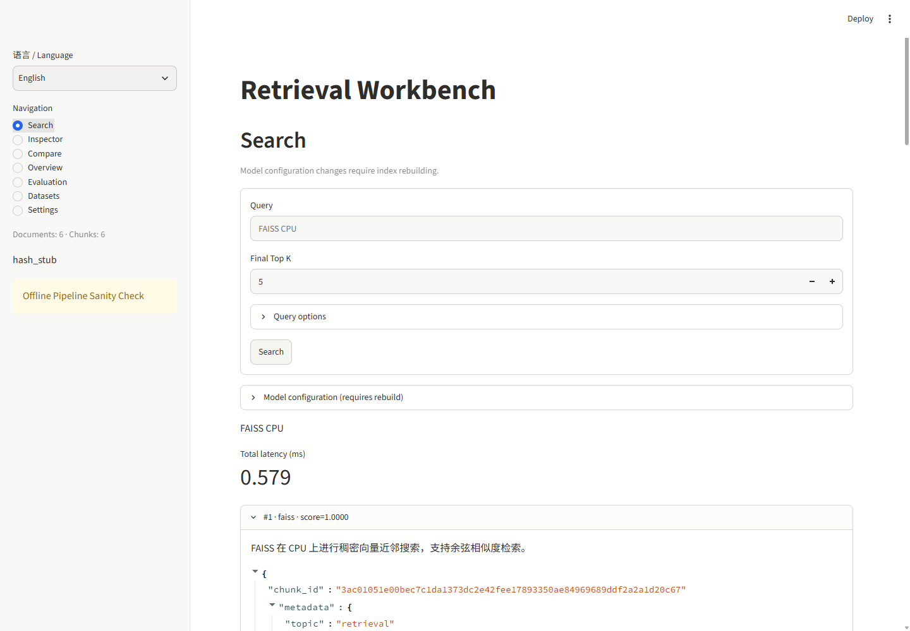
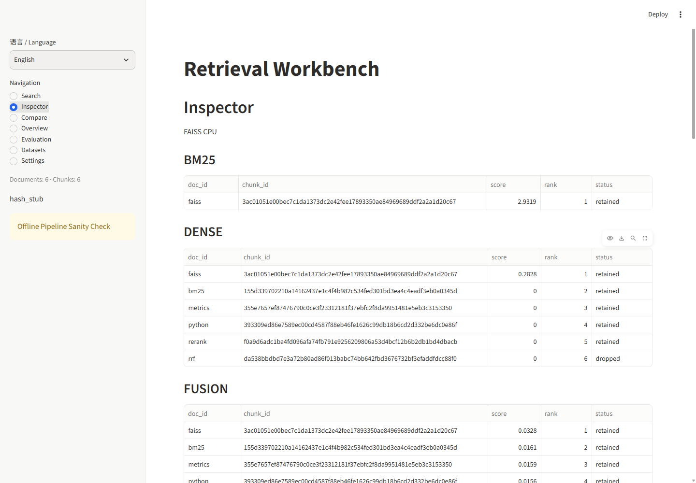
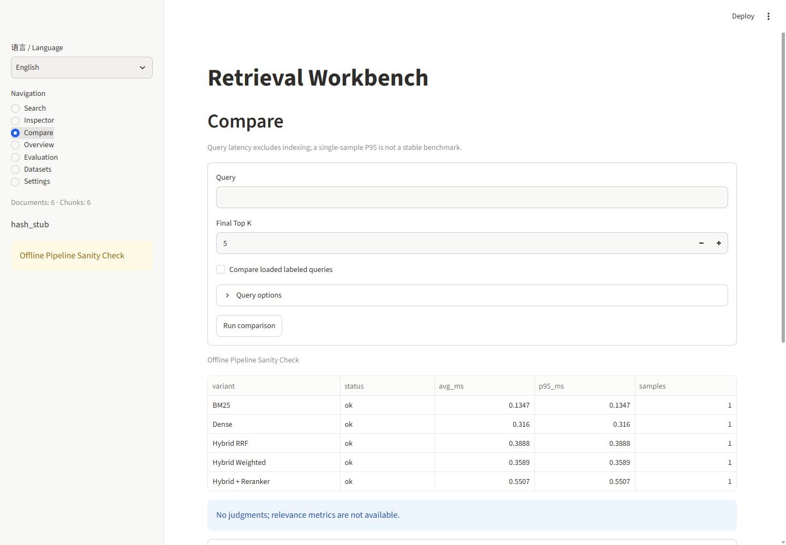
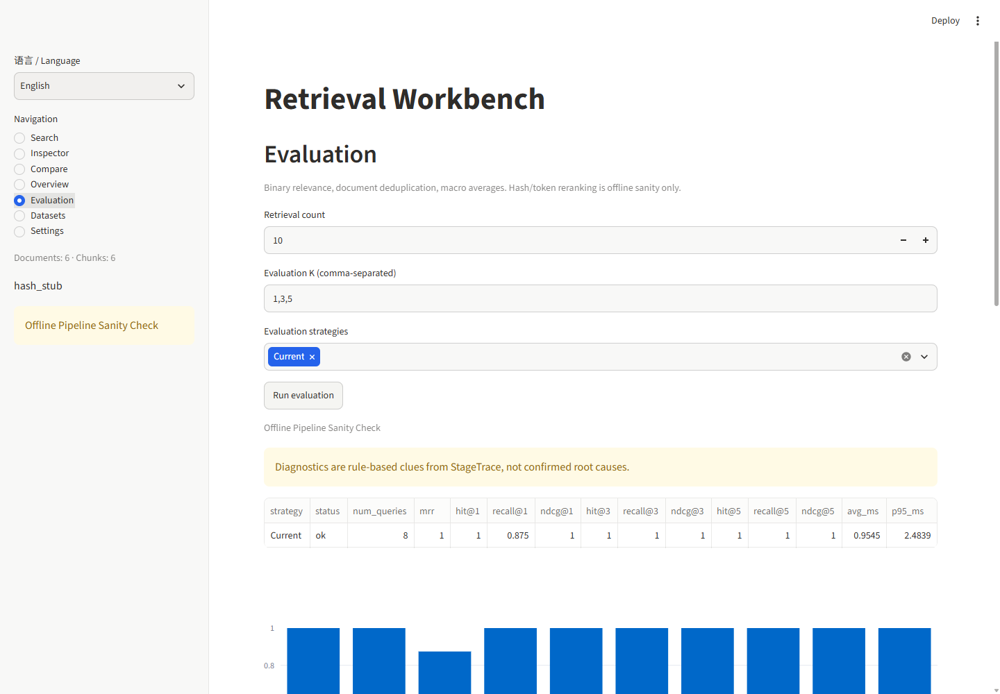
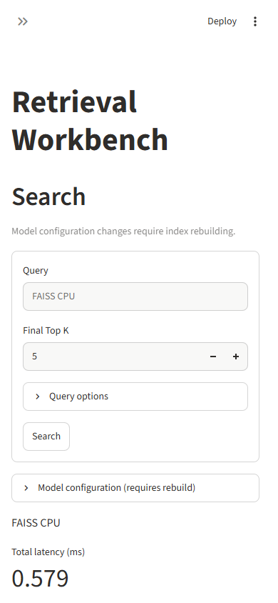
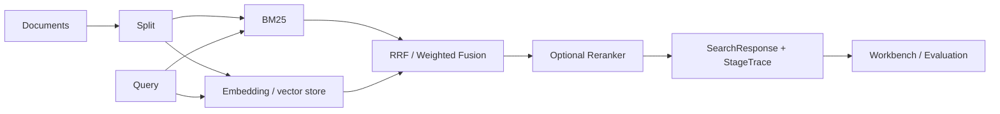

# RAG Toolkit


[](https://github.com/ericqin-ai/rag-toolkit/actions/workflows/ci.yml)
[](pyproject.toml)
[](LICENSE)

**English** | [简体中文](README.zh-CN.md)

## Introduction

A lightweight Python retrieval toolkit and bilingual Retrieval Workbench for
hybrid search, reranking, inspection and evaluation. Use a Python SDK, FastAPI,
or seven Streamlit pages backed by real retrieval operations. This project retrieves
and evaluates evidence; it does not generate LLM answers.

## Why RAG Toolkit

- Inspect all stage candidates, scores, ranks and timings instead of only final hits.
- Compare lexical/dense/fusion/reranker changes on the same data and annotations.
- Start with a CPU-only offline sanity pipeline; configure real providers separately.
- Keep BM25 and Dense visible as independent recall sources, with explicit index
  rebuild boundaries and safe configuration export.

## Core Features

- TXT/Markdown/JSONL ingestion, fixed-character or Markdown-header splitting.
- BM25, Dense, Hybrid RRF, normalized Weighted Fusion and optional reranking.
- FAISS; adapters for Elasticsearch, Sentence Transformers, CrossEncoder and
  OpenAI-compatible embedding endpoints.
- Actual StageTrace inspection and Hit@K / Recall@K / MRR / NDCG evaluation.
- Overview, Search, Inspector, Compare, Evaluation, Datasets and Settings; Chinese/
  English UI, native Light/Dark themes, Plotly, and JSON/CSV/Markdown reports.
- Session-local state, credential-redacted configuration, offline logic and AppTest tests.

## Screenshots & Demo

Real Chrome screenshots of the running application, using bundled sample data and
**Offline Pipeline Sanity Check** providers. Timings shown are individual runs,
not production benchmarks. Long pages continue below each viewport.

<details>
<summary>Seven-page desktop gallery (1440 × 1000)</summary>

**Overview**


**Search**



**Inspector**



**Compare**



**Evaluation**



**Datasets**


**Settings**


</details>

<details>
<summary>Narrow-screen example (390 × 844)</summary>



</details>

<details>
<summary>Native Dark theme and independent recall paths</summary>


</details>

[All desktop/narrow captures, manifest and reproduction commands](docs/screenshots.md).
No Demo GIF is claimed; local screen-recording steps are documented there.

## Quick Start

From the repository root with Python 3.11+ and uv installed:

```sh
uv sync --locked
uv run python examples/readme_sdk.py
uv run streamlit run src/rag_toolkit/web/app.py --server.address 127.0.0.1 --server.port 8507 --server.headless true
```

Open [localhost:8507](http://127.0.0.1:8507), select **Datasets → Load sample data**,
then Search or Evaluation. Installation may download packages; the default pipeline
and examples do not download models. Explicit `configs/default.yaml` requests real
local models and requires optional dependencies/weights; see [configuration](docs/configuration.md).

## Python SDK Example

The exact offline example in [examples/readme_sdk.py](examples/readme_sdk.py) is
executed during documentation verification. Its hash/token providers validate the
chain, not learned semantic retrieval quality.

```python
"""Exact README SDK example: Offline Pipeline Sanity Check, no model downloads."""

from rag_toolkit.pipeline import RetrievalPipeline
from rag_toolkit.schemas import Document

pipeline = RetrievalPipeline.from_config(
    {
        "embedding": {"provider": "hash_stub", "dimension": 256},
        "retriever": {"mode": "hybrid"},
        "reranker": {"enabled": True, "provider": "token_overlap", "top_k": 10},
    }
)
pipeline.add_documents(
    [
        Document(id="intro", text="FAISS supports vector search."),
        Document(id="lexical", text="BM25 supports lexical search."),
    ]
)
response = pipeline.search("vector search", top_k=2)
assert response.results[0].doc_id == "intro"
print("Offline Pipeline Sanity Check")
print(response.model_dump_json(indent=2))
```

## Retrieval Strategy Comparison

| Strategy | Retrieval behavior | When to inspect it |
|---|---|---|
| BM25 | Lexical token matching | Exact vocabulary and zero-match omissions |
| Dense | Configured embeddings + cosine search | Semantic model behavior; hash mode is sanity only |
| Hybrid RRF | Independent recall lists fused by rank | Recall overlap and rank-based fusion |
| Hybrid Weighted | Per-channel min-max scores, normalized weights | Weight sensitivity and candidate differences |
| Hybrid + Reranker | Hybrid candidates rescored by configured reranker | Pool truncation and rerank changes |

These are implemented strategies, not a claim that one wins on every corpus.
Compare/Evaluation run the actual configured models; unavailable components are
reported explicitly. Trace-based diagnosis is a **rule-based clue, not a confirmed root cause**.

## Benchmark Results

**Real-model/public-dataset benchmarks: not yet completed. No real-model scores
or production latency claims are published.**

The recorded offline sample indexes 6 chunks and evaluates 8 synthetic queries with
HashEmbedder + TokenOverlapReranker. Its actual report and measured sanity metrics
are documented separately in [benchmark status](docs/benchmarks.md) and the
[raw sample report](datasets/evaluation-report.json). They are not semantic-model benchmarks.

## Architecture



BM25 and Dense are independent recall channels. The API and Web sessions own
separate indexes. See [architecture and data contracts](docs/architecture.md).

## Configuration & Documentation

| Guide | Contents |
|---|---|
| [Documentation index](docs/index.md) | All detailed guides |
| [HTTP API](docs/api.md) | Routes, schemas, examples and error contracts |
| [Configuration](docs/configuration.md) | Parameter table, providers and rebuild rules |
| [Architecture](docs/architecture.md) | Algorithms, ownership and module layout |
| [Web workbench](docs/web-workbench.md) | Seven-page workflows |
| [Development](docs/development.md) | Offline tests, CI and Docker status |
| [Known limits](docs/limitations.md) | Persistence, scale, integrations and privacy boundaries |

Settings import/export is credential-redacted. Prefer `OPENAI_API_KEY` for API
credentials. The pipeline is in memory; one API worker is required, and restarting
loses local indexes. Optional live-model/Elasticsearch and Docker runtime validation
remain outside this release's acceptance.

## Roadmap

- [x] Modular retrieval, traces, evaluation and seven-page bilingual workbench.
- [x] Offline tests, verified SDK examples and real browser screenshots.
- [ ] Reproducible real-model/public-dataset benchmarks with raw outputs.
- [ ] Durable index restore, shared worker state and deployment authentication.
- [ ] Concrete PDF and semantic splitting extensions (currently abstract interfaces).

## Contributing

Read [AGENTS.md](AGENTS.md) and the [development guide](docs/development.md). Keep
interfaces compatible, business logic out of package initializers, tests offline,
and both READMEs synchronized. Run:

```sh
uv run pytest
uv run ruff check .
uv run ruff format --check .
uv run python scripts/verify_readme.py
```

## License

[MIT](LICENSE). The original SVG assets are covered by the same license. Optional
model weights and dependencies retain their own licenses.
