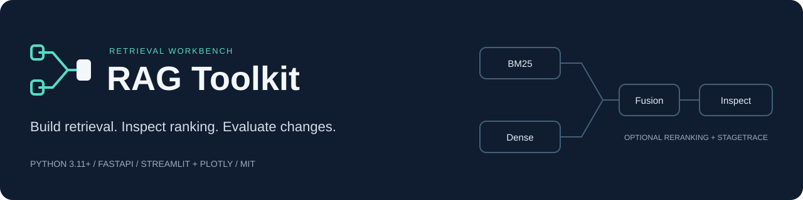
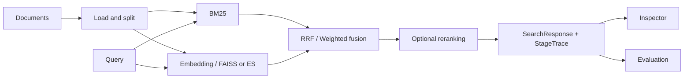

# rag-toolkit



[English](README.md) | [Chinese](README.zh-CN.md)

[Quick start](#quick-start) · [API](#api) · [Inspector](#rag-inspector) ·
[Evaluation](#measured-sample-evaluation) · [Docker](#docker-compose) · [Status](#project-status)

A lightweight and modular retrieval toolkit for hybrid search, reranking,
retrieval evaluation, and RAG applications. Python 3.11+, managed with uv.
The Inspector explains retrieval; it does not generate LLM answers.



## Project status

The requested P0 retrieval toolkit is implemented and offline-tested. This is an
initial release for local retrieval development and inspection.

| Area | Status |
|---|---|
| Ingestion, splitting, retrieval, fusion, reranking interfaces | Implemented |
| FastAPI, four-view Inspector, evaluation and examples | Implemented; offline integration tests |
| Real Sentence Transformer / CrossEncoder and Elasticsearch | Adapters implemented; live integration not verified |
| PDF and semantic splitting | Abstract extension points, as scoped |
| Docker Compose | Configuration validated; image/startup not verified (daemon unavailable) |
| Durability and multi-process shared state | Not implemented; indexes are in memory |

No claim is made that all production RAG concerns or optional extensions are complete.

## Features

- TXT, Markdown, JSONL loaders; fixed-character and Markdown-header splitting.
- BM25, dense, and hybrid retrieval; RRF and normalized weighted fusion.
- FAISS cosine search and an Elasticsearch adapter.
- Local Sentence Transformers and OpenAI-compatible embeddings; CrossEncoder reranking.
- Deterministic HashEmbedder and token-overlap reranking for CPU-only offline tests.
- Full StageTrace candidates, ranks, scores, and measured stage durations.
- Document-level Hit@K, Recall@K, MRR, NDCG@K with binary relevance.
- FastAPI endpoints and a four-view Streamlit RAG Inspector.

## Quick start

Clone the standalone repository, install uv, then run from its root directory:

```sh
git clone https://github.com/ericqin-ai/rag-toolkit.git
cd rag-toolkit
uv sync --locked
uv run python examples/basic_search.py
uv run python examples/hybrid_search.py
uv run python examples/rerank_search.py
uv run python examples/evaluate.py
```

Installation downloads packages. The tests and default examples do not download
models or connect to external services. `.python-version` selects Python 3.12;
the declared minimum is 3.11 (`uv run --python 3.11 ...`).
All three search examples accept `--query`, `--top-k`, and `--documents`.
Their output is an actual SearchResponse, including traces.

```python
from rag_toolkit.pipeline import RetrievalPipeline
from rag_toolkit.schemas import Document

pipeline = RetrievalPipeline.from_config("configs/offline.yaml")
pipeline.add_documents([Document(id="intro", text="FAISS supports vector search.")])
response = pipeline.search("vector search", top_k=5)
print(response.model_dump_json(indent=2))
```

`from_config` accepts YAML paths or mappings and injectable components.
`add_documents` replaces documents by ID and deletes obsolete chunks. Empty text
removes the old chunks. The pipeline itself is in-memory and is not thread-safe;
the HTTP service serializes operations with a lock. Remote writes are not transactional.

## API

```sh
uv run uvicorn rag_toolkit.api.app:create_app --factory --host 127.0.0.1 --port 8000 --workers 1
```

Open [interactive API docs](http://127.0.0.1:8000/docs).

| Endpoint | Request | Response |
|---|---|---|
| GET /health | none | status, document/chunk counts |
| POST /documents | documents: Document list | counts and added_chunks |
| POST /search | query, top_k (default 10) | SearchResponse with traces |
| POST /evaluate | queries, top_k, ks | EvalReport from executed searches |

Example request bodies, in the same order as the three POST endpoints:

```json
{"documents": [{"id": "intro", "text": "FAISS supports vector search.", "metadata": {}}]}
```

```json
{"query": "FAISS", "top_k": 5}
```

```json
{"queries": [{"query": "FAISS", "relevant_doc_ids": ["intro"]}], "top_k": 5, "ks": [1, 3, 5]}
```

Requests reject unknown fields and duplicate document IDs/query text. API top_k
must be an integer from 1 to 1000; evaluation K values must be positive and no
larger than top_k. Invalid requests return 422 with
`{"error": {"code": "validation_error", "message": "Invalid request", "details": [...]}}`.
Unhandled backend errors return a generic 500; details are logged server-side.
Health reports application availability, not external-provider readiness.

The API starts empty. Use one worker: separate workers do not share their indexes.
Restarting loses the in-memory index; existing external vectors alone cannot restore
local chunks or BM25 state. Elasticsearch searches are scoped to the chunks
added to the current pipeline. Use separate indexes for independent writers.

## RAG Inspector

```sh
uv run streamlit run src/rag_toolkit/web/app.py --server.address 127.0.0.1
```

Open [the Inspector](http://127.0.0.1:8501), select **Datasets**, and explicitly load
the sample dataset or upload your own:

- **Search:** query, top-k, chunk text, metadata, stage scores, JSON download.
- **Inspector:** all stage candidates including dropped chunks, rank changes,
  ranking chart, stage durations and orchestration overhead, raw traces.
- **Evaluation:** execute labeled queries, inspect aggregate/per-query metrics,
  download the actual report.
- **Datasets:** import TXT/Markdown/document JSONL and query-label JSONL;
  preview/export documents and labels; reset the session.

Web sessions have independent pipelines. The Web UI runs retrieval directly and
has a separate index from the API. Dataset changes and failed submissions clear
outdated results. Elasticsearch-backed Web sessions use unique index suffixes;
old remote session indexes need an external cleanup/lifecycle policy.

## Docker Compose

Run from the repository root with a running Docker daemon:

```sh
docker compose config --quiet
docker compose up --build -d
docker compose ps
docker compose logs --tail=100 api inspector
docker compose down
```

The Dockerfile uses Python 3.12 and uv 0.11.15, installs locked runtime dependencies,
includes libgomp for FAISS, and runs as a non-root user. Compose starts independent
API (8000) and Inspector (8501) services with health checks and offline configuration.
Host ports bind to 127.0.0.1. Images/packages require network access to build; runtime
does not require a remote model. There is no Elasticsearch service, model image,
preloaded index, or persistent index volume in this default stack.

Validation on the development host: Compose configuration can be checked locally;
Docker Desktop's Linux daemon was unavailable, so an image build and container
startup have **not** been verified here.

## Configuration and real models

`configs/default.yaml` preserves the AGENTS.md contract (local BGE embeddings,
FAISS, hybrid RRF, reranking disabled). `configs/offline.yaml` selects hash embeddings
and token-overlap reranking. Neither test substitute represents learned semantic quality.

```sh
uv sync --locked --extra local
uv run python examples/evaluate.py --config configs/default.yaml
# Install the client when using a separately configured Elasticsearch service:
uv sync --locked --extra elasticsearch
```

Real model execution is supported by adapters but is not part of the recorded sample
measurements. Initial model loading may download weights; CPU is the default device.
Set `RAG_TOOLKIT_CONFIG` before launching API/Web to use a different YAML file:

```powershell
$env:RAG_TOOLKIT_CONFIG = "$PWD/configs/default.yaml"
```

```sh
export RAG_TOOLKIT_CONFIG="$PWD/configs/default.yaml"
```

OpenAI-compatible configuration uses `provider: openai_compatible`, `model_name`,
`base_url` (including the API prefix), and optional `batch_size`. Read credentials
from `OPENAI_API_KEY`. Elasticsearch configuration needs type, url, index_name,
and dimension matching the embedder. Advanced authentication can use an injected client.
The default Docker image does not install optional local/Elasticsearch extras.

## Retrieval and data contracts

- Text JSONL: required text, optional id/metadata; errors include physical line numbers.
  Missing IDs depend on source path and line number, so moving files changes those IDs.
- Query JSONL: optional id, required query/relevant_doc_ids; query text must be unique
  within an evaluation request. See `datasets/queries.jsonl`.
- Splitting uses characters, not tokens. Markdown supports ATX headings and fenced
  code blocks. PDFLoader/SemanticSplitter are abstract extension points.
- Tokenization uses lowercase Latin words/numbers and individual CJK characters.
- BM25 defaults to k1=1.5, b=0.75 and excludes zero-match candidates.
- Dense scores are cosine similarities. Elasticsearch rejects zero vectors.
- RRF sums `1 / (rrf_k + rank)`; Weighted uses per-list min-max normalization,
  mapping constant lists to 1 and missing candidates to 0, with normalized weights.
- Candidate ties use document/chunk IDs. Stage ranks start at 1; absent ranks/scores
  are null. BM25 and dense recall are parallel sources, not a sequential transformation.
- Retrieval top-k settings cap recall; search top_k caps final output; reranker.top_k
  caps the reranking pool. Direct pipeline top_k=0 returns empty results.
- FAISS updates rebuild an exact index; current stable tie handling retrieves all
  candidates before final ranking. This implementation targets small/medium corpora.

## Measured sample evaluation

Executed on 2026-11-25 with Python 3.12.9 on Windows:

```sh
uv run python examples/evaluate.py --output datasets/evaluation-report.json
```

Actual output: **6 indexed chunks, 8 evaluated queries**. Configuration:
`configs/offline.yaml` (HashEmbedder, FAISS, hybrid RRF, TokenOverlapReranker),
search top_k=5, evaluation K=1/3/5. Inputs: `datasets/documents.jsonl` and
`datasets/queries.jsonl`. Full per-query output: [recorded report](datasets/evaluation-report.json).

| Metric | Measured value |
|---|---|
| hit@1 | 1.000 |
| hit@3 | 1.000 |
| hit@5 | 1.000 |
| mrr | 1.000 |
| ndcg@1 | 1.000 |
| ndcg@3 | 1.000 |
| ndcg@5 | 1.000 |
| recall@1 | 0.875 |
| recall@3 | 1.000 |
| recall@5 | 1.000 |

This tiny synthetic set validates the retrieval/evaluation chain. These are not
production benchmarks, real-model scores, throughput measurements, or latency claims.
Evaluation deduplicates document IDs before computing binary relevance metrics,
macro-averages across queries, and scores empty relevance sets as zero. MRR is
computed over the returned ranking and therefore depends on retrieval truncation.

## Tests and CI

```sh
uv sync --locked --group dev
uv run pytest
uv run ruff check .
```

Tests use real FAISS plus injected model/HTTP/Elasticsearch clients; FastAPI
TestClient and Streamlit AppTest verify API/UI behavior without external services.
On the Windows development host, TestClient required sandbox-external execution
because the sandbox restricted event-loop operations. Test execution remained offline.

The repository-root `.github/workflows/ci.yml` runs the standalone project
for Python 3.11/3.12 on Ubuntu: locked dependency installation, Ruff, pytest,
the evaluation example, and Compose configuration validation. See [GitHub Actions](https://github.com/ericqin-ai/rag-toolkit/actions) for run results.

## Project layout

```text
src/rag_toolkit/
  api/          # app factory, HTTP contracts, locked service
  web/          # Streamlit views, dataset parsing, trace presentation
  schemas/      # validated public models
  loaders/      # TXT, Markdown, JSONL, PDF abstraction
  splitters/    # fixed, Markdown, semantic abstraction
  embeddings/   # base, hash, local, OpenAI-compatible
  stores/       # base, FAISS, Elasticsearch
  retrievers/   # base, BM25, dense, hybrid
  fusion/       # base, RRF, weighted
  rerankers/    # base, CrossEncoder, token-overlap
  pipeline/     # RetrievalPipeline
  evaluation/   # metrics and evaluator
  utils/        # shared text, ranking, validation helpers
configs/ datasets/ examples/ tests/
```

Package `__init__.py` files only forward imports and define __all__.
See [AGENTS.md](AGENTS.md) for development contracts.

## License

[MIT](LICENSE). Optional model weights and third-party dependencies retain their own licenses.
