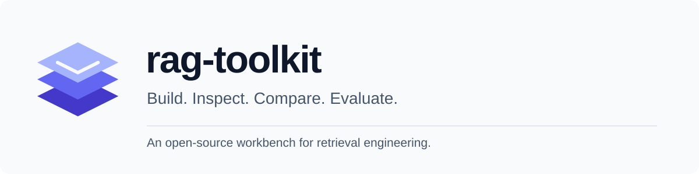
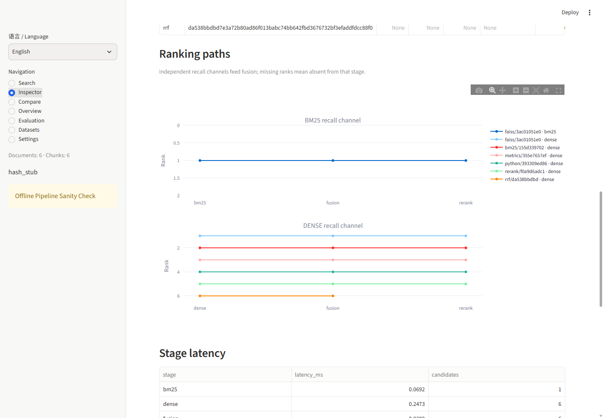
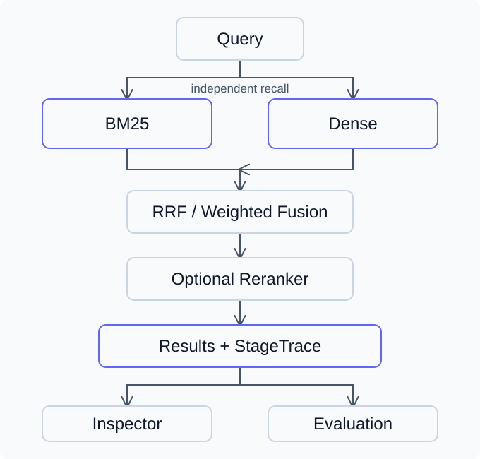

<picture>
  <source media="(prefers-color-scheme: dark)" srcset="docs/assets/banner-dark.svg">
  <source media="(prefers-color-scheme: light)" srcset="docs/assets/banner-light.svg">
  
</picture>

[](https://github.com/ericqin-ai/rag-toolkit/actions/workflows/ci.yml)
[](pyproject.toml)
[](LICENSE)

[English](README.md) | **简体中文**

# rag-toolkit

**面向检索算法工程师的开源实验工作台。**

Build. Inspect. Compare. Evaluate.

通过 Python SDK 与可视化工作台构建混合检索链路、检查候选排名、对比策略，
并使用自己的文档和相关性标注评估检索效果。

[快速开始](#快速开始) · [文档](docs/index.md) · [截图](docs/screenshots.md)

## 产品预览



**Visual Inspector**：沿独立召回、融合和重排阶段追踪候选排名。
截图来自实际应用，使用仓库样例数据与 **Offline Pipeline Sanity Check** Provider。
画面耗时仅属于单次运行，不代表生产性能。[完整截图与复现方式](docs/screenshots.md)。

## 核心功能

| 能力 | 可以做什么 |
|---|---|
| **Hybrid Retrieval · 混合检索** | BM25 与 Dense 独立召回，支持 RRF、加权融合及可选重排。 |
| **Visual Inspector · 链路检查** | 查看候选排名、分数、淘汰情况及各阶段耗时。 |
| **Strategy Comparison · 策略对比** | 基于相同文档与相关性标注，对比不同检索配置。 |
| **Evaluation · 效果评测** | 计算 Hit@K、Recall@K、MRR、NDCG，查看查询耗时并导出报告。 |

导入 TXT、Markdown 或 JSONL，以 FAISS 离线起步，再配置真实嵌入模型、
重排模型或 Elasticsearch 适配器。[Provider 与配置](docs/configuration.md)。

## 快速开始

安装 **Python 3.11+** 与 [uv](https://docs.astral.sh/uv/getting-started/installation/)，
在仓库根目录运行：

```sh
uv sync --locked
uv run python examples/readme_sdk.py
uv run streamlit run src/rag_toolkit/web/app.py --server.address 127.0.0.1 --server.port 8507 --server.headless true
```

打开 [localhost:8507](http://127.0.0.1:8507)，选择 **Datasets → 加载样例数据**，
执行 Search，再打开 Inspector 或 Compare。

默认链路使用离线验证 Provider，无须下载模型；安装依赖可能联网。
`configs/default.yaml` 使用真实本地模型，所需依赖与权重见[配置指南](docs/configuration.md)。

## Python SDK 示例

此 **Offline Pipeline Sanity Check** 使用 Hash 嵌入和词项重排，
用于验证链路，不代表真实语义模型的检索质量。
可执行源码见 [examples/readme_sdk.py](examples/readme_sdk.py)。

```python
from rag_toolkit.pipeline import RetrievalPipeline
from rag_toolkit.schemas import Document

pipeline = RetrievalPipeline.from_config("configs/offline.yaml")
pipeline.add_documents(
    [
        Document(id="intro", text="FAISS supports vector search."),
        Document(id="lexical", text="BM25 supports lexical search."),
    ]
)
response = pipeline.search("vector search", top_k=2)
assert response.results[0].doc_id == "intro"
print("Offline Pipeline Sanity Check")
print(response.model_dump_json(indent=2))
```

## 架构

<picture>
  <source media="(prefers-color-scheme: dark)" srcset="docs/assets/architecture-dark.svg">
  <source media="(prefers-color-scheme: light)" srcset="docs/assets/architecture-light.svg">
  
</picture>

BM25 与 Dense 是独立召回通道，当前实现按顺序执行。
图中展示混合检索路径；重排可跳过。[算法、数据契约与索引归属](docs/architecture.md)。

## Benchmark 状态

真实模型与公开数据集 Benchmark **尚未完成**。
离线验证报告仅用于确认链路可运行。
[评测状态、已记录报告与后续协议](docs/benchmarks.md)。

## 文档

| 指南 | 内容 |
|---|---|
| [文档索引](docs/index.md) | 全部指南与项目记录（详细文档为英文） |
| [Web 工作台](docs/web-workbench.md) | Inspector、Compare 与 Evaluation 工作流 |
| [配置](docs/configuration.md) | Provider、参数与索引重建 |
| [架构](docs/architecture.md) | 检索策略与数据契约 |
| [HTTP API](docs/api.md) | 路由、结构与请求示例 |
| [开发指南](docs/development.md) | 贡献、测试、CI 与 Docker |
| [已知限制](docs/limitations.md) | 内存状态、规模与集成边界 |

## 路线图

- [x] 混合检索、StageTrace、策略对比与评测工作台。
- [x] 离线验证与真实应用截图。
- [ ] 可复现的真实模型/公开数据集 Benchmark 及原始输出。
- [ ] 索引恢复、多 worker 共享状态与部署鉴权。
- [ ] PDF 加载与语义切分的具体扩展实现。

## 开源许可

[MIT](LICENSE)，包含原创品牌 SVG。可选模型权重与第三方依赖保留各自许可。
