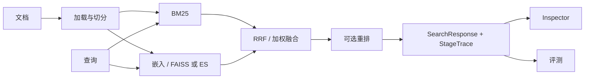

# rag-toolkit


[English](README.md) | [中文](README.zh-CN.md)

[快速开始](#快速开始) · [API](#api) · [Inspector](#rag-inspector) ·
[实测评估](#实际运行的样例评测) · [Docker](#docker-compose) · [完成情况](#项目完成情况)

轻量、模块化、可配置、可评测的 RAG 检索工具箱，使用 Python 3.11+ 和 uv。
Inspector 用于解释检索过程，不包含 LLM 答案生成。



## 项目完成情况

本次要求的 P0 检索工具箱已实现，并通过离线测试，适用于本地检索开发与过程分析。

| 范围 | 状态 |
|---|---|
| 加载、切分、检索、融合、重排接口 | 已实现 |
| FastAPI、四视图 Inspector、评测与示例 | 已实现，离线集成测试覆盖 |
| 真实嵌入 / CrossEncoder / Elasticsearch | 适配器已实现，真实环境集成未验证 |
| PDF、语义切分 | 按约定保留抽象扩展点 |
| Docker Compose | 配置检查通过；daemon 不可用，构建和启动未验证 |
| 持久化与多进程共享状态 | 尚未实现，索引驻留内存 |

这是一版面向本地使用的初始发布，不宣称所有生产 RAG 能力或可选扩展均已完成。

## 功能

- TXT、Markdown、JSONL 加载；按字符长度和 Markdown 标题切分。
- BM25、Dense、Hybrid 检索；RRF 和归一化加权融合。
- FAISS 余弦检索、Elasticsearch 存储适配器。
- 本地 Sentence Transformers、OpenAI 兼容嵌入、CrossEncoder 重排。
- 用于离线 CPU 测试的确定性 HashEmbedder 和词项重排器。
- 完整 StageTrace：各阶段候选、排名、分数和实际耗时。
- 按文档评测 Hit@K、Recall@K、MRR、NDCG@K。
- FastAPI 接口与四个视图的 Streamlit RAG Inspector。

## 快速开始

安装 uv 后，克隆独立仓库并在仓库根目录运行：

```powershell
git clone https://github.com/ericqin-ai/rag-toolkit.git
cd rag-toolkit
uv sync --locked
uv run python examples/basic_search.py
uv run python examples/hybrid_search.py
uv run python examples/rerank_search.py
uv run python examples/evaluate.py
```

首次安装需要下载依赖；测试与默认示例不下载模型或访问外部服务。
`.python-version` 默认选择 3.12，声明的最低版本为 3.11，
可用 `uv run --python 3.11 ...` 显式选择。
三个搜索示例均支持 `--query`、`--top-k`、`--documents`，输出真实 SearchResponse JSON。

```python
from rag_toolkit.pipeline import RetrievalPipeline
from rag_toolkit.schemas import Document

pipeline = RetrievalPipeline.from_config("configs/offline.yaml")
pipeline.add_documents([Document(id="intro", text="FAISS 支持向量检索。")])
print(pipeline.search("向量检索", top_k=5).model_dump_json(indent=2))
```

`from_config` 接受 YAML 路径或 mapping，并支持组件注入。
`add_documents` 按文档 ID 替换旧版本并删除过期 chunk；空文本删除原有 chunk。
原始流水线驻留内存，不支持并发写入，HTTP 服务通过锁串行访问；远程写入不提供事务保证。

## API

```powershell
uv run uvicorn rag_toolkit.api.app:create_app --factory --host 127.0.0.1 --port 8000 --workers 1
```

打开 [交互式 API 文档](http://127.0.0.1:8000/docs)。

| 方法与路径 | 请求 | 响应 |
|---|---|---|
| GET /health | 无 | 状态、文档数、chunk 数 |
| POST /documents | documents: Document 列表 | 总数与 added_chunks |
| POST /search | query、top_k（默认 10） | 包含 traces 的 SearchResponse |
| POST /evaluate | queries、top_k、ks | 实际执行检索后生成的 EvalReport |

三个 POST 接口的请求体示例：

```json
{"documents": [{"id": "intro", "text": "FAISS 支持向量检索。", "metadata": {}}]}
```

```json
{"query": "FAISS", "top_k": 5}
```

```json
{"queries": [{"query": "FAISS", "relevant_doc_ids": ["intro"]}], "top_k": 5, "ks": [1, 3, 5]}
```

请求拒绝未知字段、批次内重复文档 ID、评测请求内重复查询文本。
API 的 top_k 必须是 1–1000 的整数；评测 K 必须为正且不超过 top_k。
非法请求返回 422，错误统一为
`{"error": {"code": "validation_error", "message": "Invalid request", "details": [...]}}`。
未处理的后端异常返回通用 500，详情记录在服务端日志中。
健康检查反映应用可访问性，不探测外部模型或服务。

API 启动时索引为空。使用单 worker，多进程不共享内存数据；重启后内存索引丢失。
已有外部向量也无法单独恢复本地 chunk 和 BM25 状态。Elasticsearch 搜索限定于当前流水线
已添加的 chunk；独立写入方应使用独立索引。

## RAG Inspector

```powershell
uv run streamlit run src/rag_toolkit/web/app.py --server.address 127.0.0.1
```

打开 [Inspector](http://127.0.0.1:8501)，在 **Datasets** 显式加载样例或上传数据。

- **Search**：查询、top-k、文本片段、元数据、阶段分数及结果下载。
- **Inspector**：包含后续被淘汰 chunk 的全部阶段候选、排名变化及折线图、
  阶段耗时和编排开销、原始 StageTrace。
- **Evaluation**：运行标注查询，查看汇总及逐查询指标，下载实际评测报告。
- **Datasets**：导入 TXT、Markdown、文档 JSONL 和标注查询 JSONL；
  浏览及导出当前文档和标注；清空会话。

Web 会话各自持有独立流水线，直接执行检索，不调用 API，也不与 API 共享索引。
数据变化和失败提交会清除过时结果。
使用 Elasticsearch 时，每个 Web 会话分配独立索引后缀；
旧会话的远程索引需要通过外部清理工具或生命周期策略清理。

## Docker Compose

在仓库根目录运行，要求 Docker daemon 已启动：

```powershell
docker compose config --quiet
docker compose up --build -d
docker compose ps
docker compose logs --tail=100 api inspector
docker compose down
```

Dockerfile 使用 Python 3.12、uv 0.11.15 和锁定的运行依赖，安装 FAISS 所需 libgomp，
以非 root 用户运行。Compose 启动独立的 API（8000）与 Inspector（8501），
配置健康检查和离线检索，宿主机端口仅绑定 127.0.0.1。
构建镜像和安装依赖需要网络，默认运行不依赖远程模型。
默认栈不包含 Elasticsearch、模型镜像、预载索引或索引持久卷。

开发机验证范围：可在本地检查 Compose 配置；Docker Desktop Linux daemon 不可用，
因此**尚未验证镜像构建或容器启动**。

## 配置与真实模型

`configs/default.yaml` 保持 AGENTS.md 规定的默认值：本地 BGE 嵌入、FAISS、Hybrid RRF、
关闭重排。`configs/offline.yaml` 使用 HashEmbedder 和词项重排器，二者均不能代表
真实语义模型质量。

```powershell
uv sync --locked --extra local
uv run python examples/evaluate.py --config configs/default.yaml
# 使用另行配置的 Elasticsearch 服务时安装客户端：
uv sync --locked --extra elasticsearch
```

适配器支持真实模型，但本次记录的样例指标没有运行真实模型。
首次加载真实模型可能下载权重；默认设备为 CPU。
API/Web 使用其他配置时，在启动前设置环境变量：

```powershell
$env:RAG_TOOLKIT_CONFIG = "$PWD/configs/default.yaml"
```

```sh
export RAG_TOOLKIT_CONFIG="$PWD/configs/default.yaml"
```

OpenAI 兼容嵌入使用 provider、model_name、base_url（含 API 前缀）及可选 batch_size，
密钥读取 OPENAI_API_KEY。Elasticsearch 配置 type、url、index_name、dimension，
维度必须匹配嵌入模型；高级身份验证可以注入已配置的客户端。
默认 Docker 镜像未安装 local、elasticsearch 可选依赖。

## 检索与数据契约

- 文档 JSONL 必需 text，可选 id、metadata；错误包含物理行号。
  自动生成的 ID 依赖文件路径和行号，移动文件会改变这些 ID。
- 标注 JSONL 可选 id，必需 query、relevant_doc_ids；同次评测内 query 文本唯一。
  参见 `datasets/queries.jsonl`。
- 按字符而非 token 切分；Markdown 支持 ATX 标题、围栏代码块。
  PDFLoader、SemanticSplitter 为抽象扩展点。
- 分词使用小写拉丁词、数字及单个汉字。BM25 默认 k1=1.5、b=0.75，不返回零匹配候选。
- Dense 分数为余弦相似度；Elasticsearch 不接受零向量。
- RRF 对 `1 / (rrf_k + rank)` 求和；Weighted 逐列表 min-max 归一化，
  常数列表映射为 1，缺失候选为 0，权重归一化后求和。
- 同分按文档/chunk ID 排序；排名从 1 开始，缺失阶段排名/分数为 null。
  BM25 与 Dense 是并行召回，排名差异不代表顺序处理关系。
- 检索 top-k 限制召回；search.top_k 限制最终返回；reranker.top_k 限制重排候选池。
  直接调用流水线时 top_k=0 返回空结果。
- FAISS 更新重建精确索引，当前为稳定处理同分边界而取回所有候选后排序，适合小中型语料。

## 实际运行的样例评测

2026-11-25，在 Windows、Python 3.12.9 上实际执行：

```powershell
uv run python examples/evaluate.py --output datasets/evaluation-report.json
```

实际输出为 **6 个索引 chunk、8 条评测查询**。
配置为 `configs/offline.yaml`：HashEmbedder、FAISS、Hybrid RRF、TokenOverlapReranker。
检索 top_k=5，评测 K=1/3/5；输入为 `datasets/documents.jsonl`、`datasets/queries.jsonl`。
完整逐查询结果见 [实际评测报告](datasets/evaluation-report.json)。

| 指标 | 实测值 |
|---|---|
| hit@1 | 1.000 |
| hit@3 | 1.000 |
| hit@5 | 1.000 |
| mrr | 1.000 |
| ndcg@1 | 1.000 |
| ndcg@3 | 1.000 |
| ndcg@5 | 1.000 |
| recall@1 | 0.875 |
| recall@3 | 1.000 |
| recall@5 | 1.000 |

这个小型合成集仅验证检索与评测链路，不是生产基准、真实模型成绩、吞吐测试或延迟承诺。
评测先按文档 ID 去重，再计算二元相关性指标并按查询宏平均；空相关集得分为零。
MRR 针对返回列表计算，因此受检索截断影响。

## 测试与 CI

```powershell
uv sync --locked --group dev
uv run pytest
uv run ruff check .
```

测试实际运行 FAISS，真实模型、HTTP、Elasticsearch 使用注入客户端验证，
FastAPI TestClient 和 Streamlit AppTest 覆盖 API/UI 行为，不连接外部服务。
Windows 开发机因沙箱事件循环限制，TestClient 在获准的沙箱外环境执行，测试仍保持离线。

仓库根目录 `.github/workflows/ci.yml` 检查本独立项目，
在 Ubuntu、Python 3.11/3.12 下执行锁定依赖安装、Ruff、pytest、评测示例、Compose 配置检查，
运行状态见 [GitHub Actions](https://github.com/ericqin-ai/rag-toolkit/actions)。

## 项目结构

```text
src/rag_toolkit/
  api/          # 应用工厂、HTTP 模型、带锁服务
  web/          # Streamlit 视图、数据解析、阶段展示
  schemas/      # 公共数据模型
  loaders/      # TXT、Markdown、JSONL、PDF 抽象
  splitters/    # 固定长度、Markdown、语义切分抽象
  embeddings/   # 抽象、hash、本地、OpenAI 兼容
  stores/       # 抽象、FAISS、Elasticsearch
  retrievers/   # 抽象、BM25、Dense、Hybrid
  fusion/       # 抽象、RRF、Weighted
  rerankers/    # 抽象、CrossEncoder、词项重排
  pipeline/     # RetrievalPipeline
  evaluation/   # 指标与评测器
  utils/        # 文本、排名、校验工具
configs/ datasets/ examples/ tests/
```

所有包入口只保留导入和 __all__。开发契约见 [AGENTS.md](AGENTS.md)。

## 许可证

[MIT](LICENSE)。可选模型权重和第三方依赖各自遵循其原有许可证。
