# RAG Toolkit

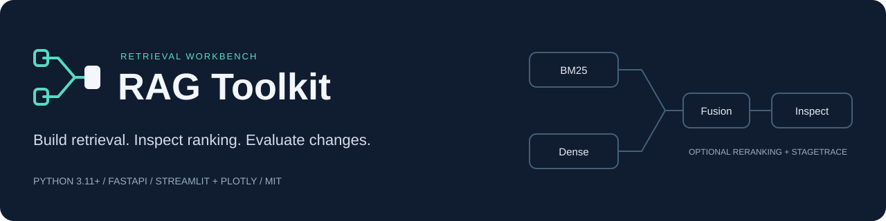

[](https://github.com/ericqin-ai/rag-toolkit/actions/workflows/ci.yml)
[](pyproject.toml)
[](LICENSE)

[English](README.md) | **简体中文**

## 项目简介

轻量 Python 检索工具箱与双语 Retrieval Workbench，支持混合检索、重排、链路检查和评测。
可通过 Python SDK、FastAPI 或七个 Streamlit 页面调用真实检索流程。
本项目负责检索和评估证据，不生成 LLM 答案。

## 为什么选择 RAG Toolkit

- 查看各阶段全部候选、分数、排名和耗时，保留被淘汰的候选。
- 在同一份数据与标注上对比词项、向量、融合及重排策略。
- 从 CPU 离线链路验证开始，再单独配置真实模型服务。
- BM25 与 Dense 独立展示；明确索引重建边界，配置导出统一脱敏。

## 核心功能

- TXT/Markdown/JSONL 导入；固定字符长度或 Markdown 标题切分。
- BM25、Dense、Hybrid RRF、归一化加权融合与可选 Reranker。
- FAISS；Elasticsearch、Sentence Transformers、CrossEncoder 和 OpenAI 兼容嵌入适配器。
- 实际 StageTrace，以及 Hit@K / Recall@K / MRR / NDCG 评测。
- Overview、Search、Inspector、Compare、Evaluation、Datasets、Settings 七页；
  中英文切换、原生 Light/Dark、Plotly 和 JSON/CSV/Markdown 报告。
- 会话隔离、配置凭据脱敏、离线逻辑测试与 AppTest 交互测试。

## 截图与演示

以下是实际启动应用后由 Chrome 截取的真实画面，使用仓库样例与
**Offline Pipeline Sanity Check** 实现。画面中的耗时仅属于该次运行，不代表生产 Benchmark。
长页面可继续向下滚动。

<details>
<summary>七个页面的桌面截图（1440 × 1000）</summary>

**Overview**

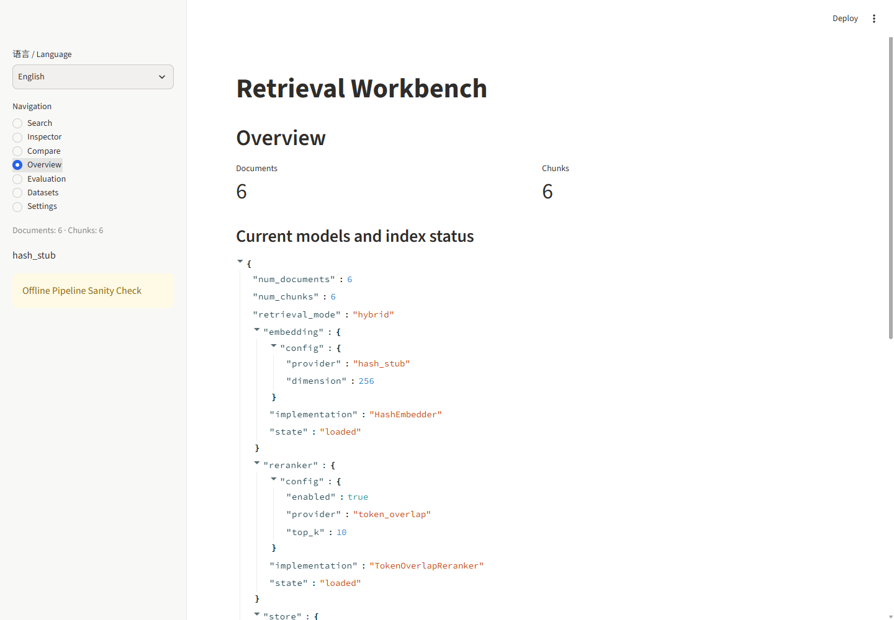

**Search**

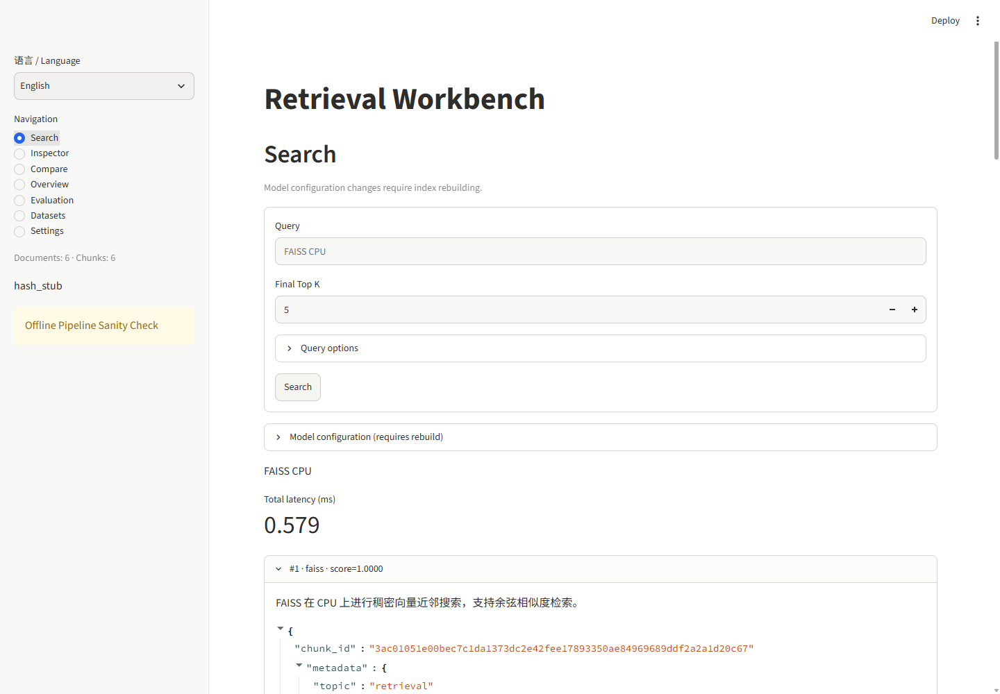

**Inspector**

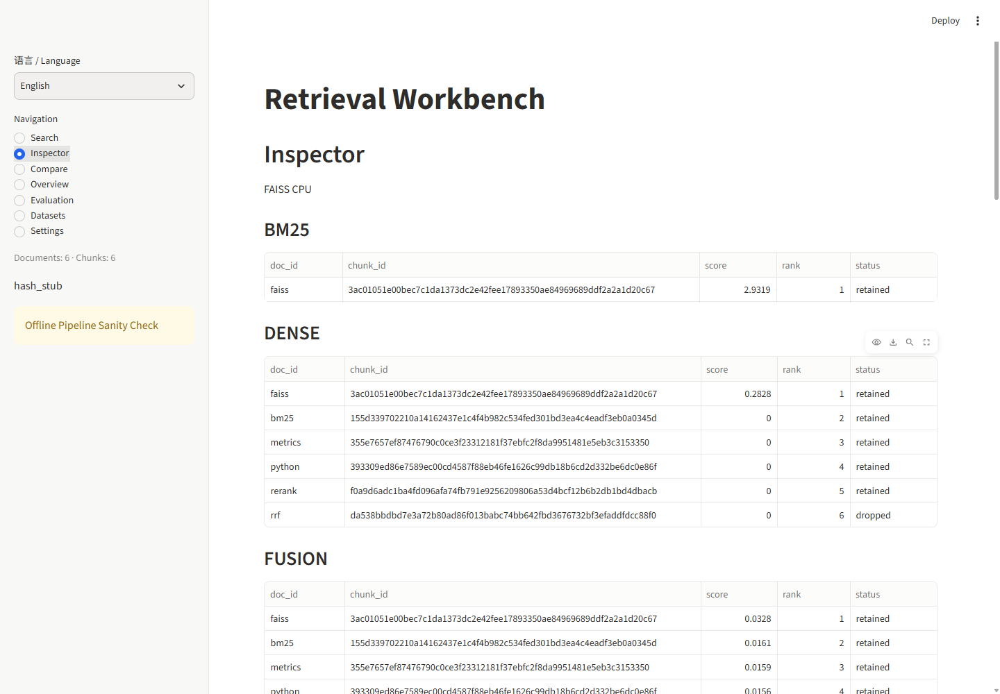

**Compare**

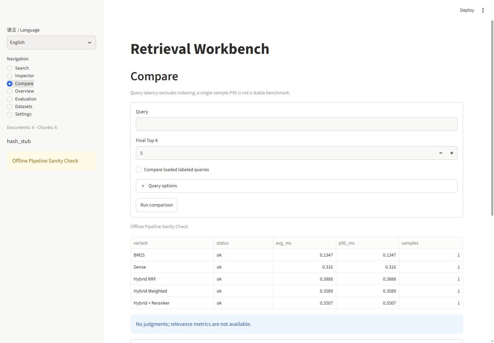

**Evaluation**

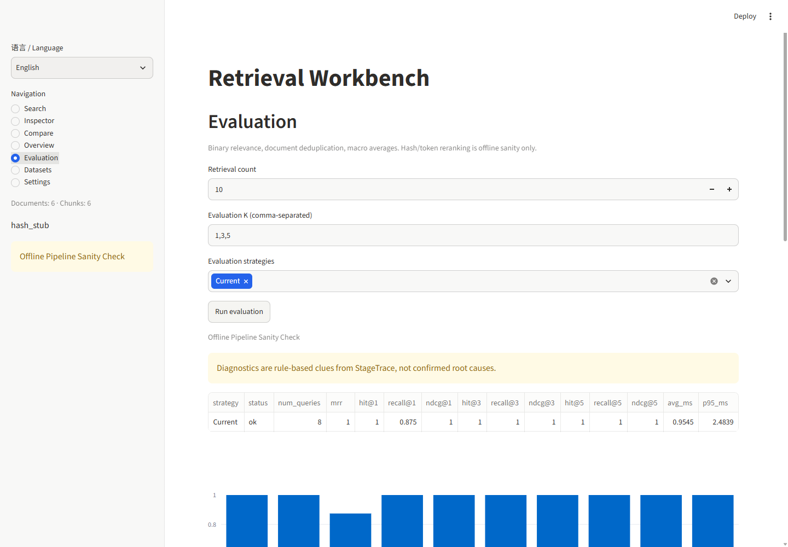

**Datasets**

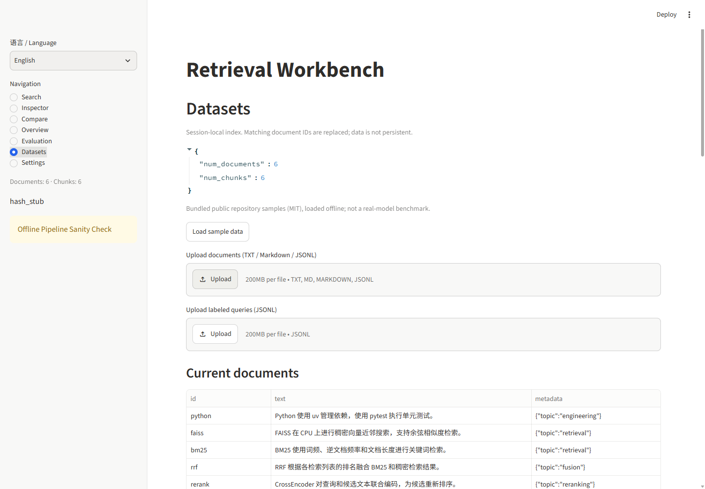

**Settings**

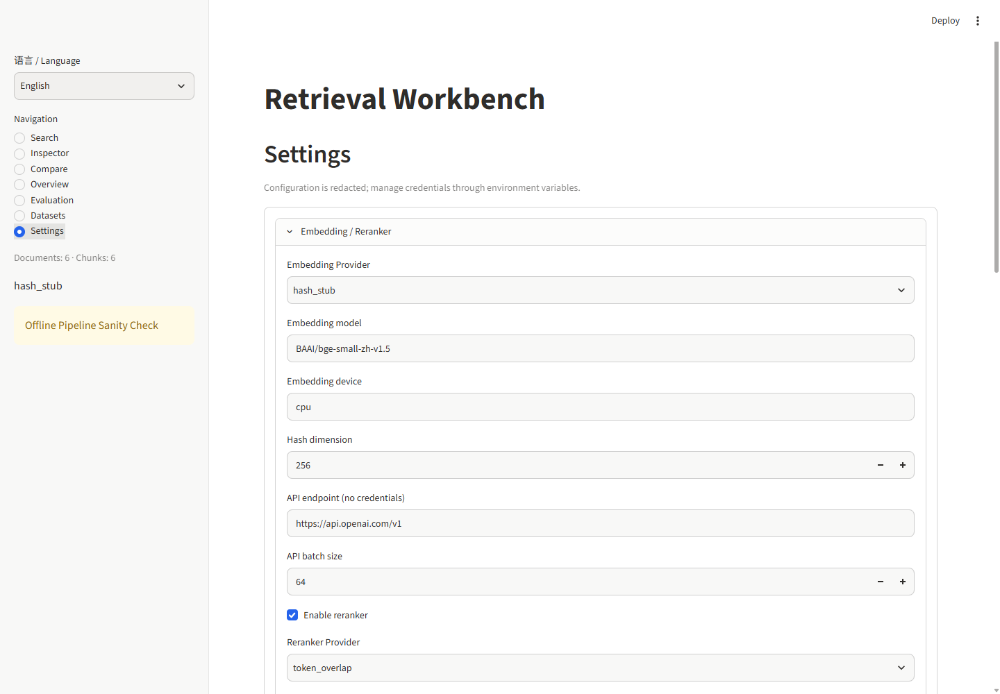

</details>

<details>
<summary>窄屏示例（390 × 844）</summary>

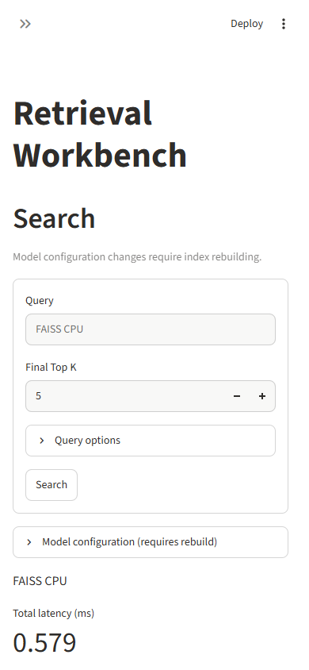

</details>

<details>
<summary>原生 Dark 主题与独立召回通道</summary>

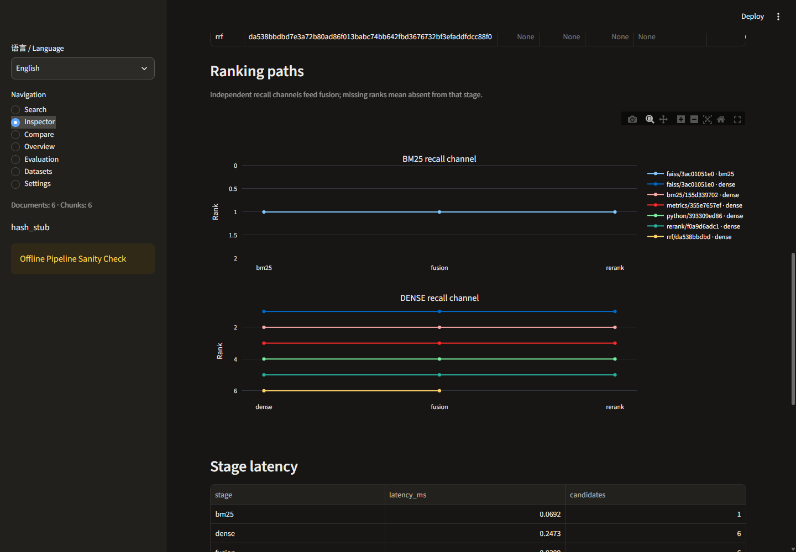

</details>

[全部桌面/窄屏截图、记录清单与复现命令](docs/screenshots.md)。未提供 Demo GIF；
文档中列出了本地录屏步骤，没有用设计图代替应用截图。

## 快速开始

安装 Python 3.11+ 与 uv 后，在仓库根目录运行：

```sh
uv sync --locked
uv run python examples/readme_sdk.py
uv run streamlit run src/rag_toolkit/web/app.py --server.address 127.0.0.1 --server.port 8507 --server.headless true
```

打开 [localhost:8507](http://127.0.0.1:8507)，选择 **Datasets → 加载样例数据**，再使用
Search 或 Evaluation。安装依赖可能联网；默认链路和示例不下载模型。
显式加载 `configs/default.yaml` 会使用真实本地模型，需要额外依赖与模型权重，详见
[配置指南](docs/configuration.md)。

## Python SDK 示例

以下代码与 [examples/readme_sdk.py](examples/readme_sdk.py) 一致，已实际执行验证。
Hash/词项重排用于验证链路，不代表真实语义模型的检索质量。

```python
"""Exact README SDK example: Offline Pipeline Sanity Check, no model downloads."""

from rag_toolkit.pipeline import RetrievalPipeline
from rag_toolkit.schemas import Document

pipeline = RetrievalPipeline.from_config(
    {
        "embedding": {"provider": "hash_stub", "dimension": 256},
        "retriever": {"mode": "hybrid"},
        "reranker": {"enabled": True, "provider": "token_overlap", "top_k": 10},
    }
)
pipeline.add_documents(
    [
        Document(id="intro", text="FAISS supports vector search."),
        Document(id="lexical", text="BM25 supports lexical search."),
    ]
)
response = pipeline.search("vector search", top_k=2)
assert response.results[0].doc_id == "intro"
print("Offline Pipeline Sanity Check")
print(response.model_dump_json(indent=2))
```

## 检索策略对比

| 策略 | 实际行为 | 适合检查 |
|---|---|---|
| BM25 | 词项匹配 | 精确词汇、零匹配遗漏 |
| Dense | 配置的 Embedding + 余弦检索 | 模型语义表现；Hash 模式仅用于验证 |
| Hybrid RRF | 独立召回通道按排名融合 | 召回重叠与排名融合 |
| Hybrid Weighted | 通道内 min-max 分数与归一化权重 | 权重敏感性和候选差异 |
| Hybrid + Reranker | 重排 Hybrid 候选池 | 候选截断与重排名次变化 |

以上是已实现的策略，不宣称某一策略适用于所有语料。Compare/Evaluation 运行实际配置的模型，
缺失组件会明确标记不可用。StageTrace 诊断是**规则推断线索，不是已确认根因**。

## Benchmark 结果

**尚未完成真实模型与公开数据集 Benchmark；不公布虚构的真实模型分数或生产延迟。**

已记录的离线样例使用 HashEmbedder + TokenOverlapReranker，索引 6 个 Chunk、评估 8 条合成 Query。
真实运行报告与链路验证指标见 [评测状态说明](docs/benchmarks.md) 和
[样例原始报告](datasets/evaluation-report.json)，不能视为语义模型 Benchmark。

## 架构

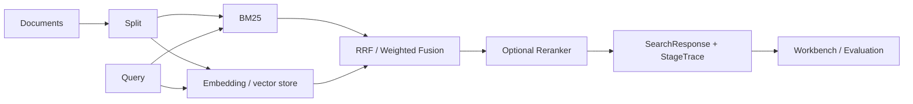

BM25 与 Dense 是独立召回通道；API 与各个 Web 会话分别拥有索引。
详见 [架构与数据契约](docs/architecture.md)。

## 配置与文档

| 文档 | 内容 |
|---|---|
| [文档索引](docs/index.md) | 全部详细指南（英文） |
| [HTTP API](docs/api.md) | 路由、结构、示例与错误契约 |
| [配置参数](docs/configuration.md) | 参数表、Provider 与重建规则 |
| [架构设计](docs/architecture.md) | 算法、状态归属与模块分层 |
| [Web 工作台](docs/web-workbench.md) | 七页工作流 |
| [开发指南](docs/development.md) | 离线测试、CI 与 Docker 验证范围 |
| [已知限制](docs/limitations.md) | 持久化、规模、可选集成与隐私边界 |

Settings 配置导入导出严格脱敏，API 凭据优先通过 `OPENAI_API_KEY` 管理。
索引保存在内存中；API 应使用单 worker，重启会丢失本地索引。
真实模型/Elasticsearch 在线集成与 Docker 容器运行尚未纳入本次验收。

## 路线图

- [x] 模块化检索、Trace、评测与七页双语工作台。
- [x] 离线测试、已验证 SDK 示例与真实浏览器截图。
- [ ] 可复现的真实模型/公开数据集评测及原始输出。
- [ ] 索引恢复、多 worker 共享状态与部署鉴权。
- [ ] PDF 与语义切分的具体扩展（当前为抽象接口）。

## 参与贡献

请阅读 [AGENTS.md](AGENTS.md) 与 [开发指南](docs/development.md)。保持公开接口兼容，
不要在包初始化文件中写业务逻辑，测试保持离线，并同步两种语言的 README。运行：

```sh
uv run pytest
uv run ruff check .
uv run ruff format --check .
uv run python scripts/verify_readme.py
```

## 开源许可

[MIT](LICENSE)。原创 SVG 资产使用相同许可；可选模型权重与第三方依赖保留各自的许可。
