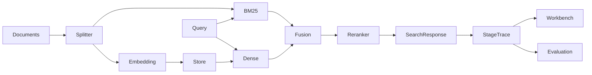

# Architecture

## Retrieval and data contracts

- Text JSONL: required text, optional id/metadata; errors include physical line numbers.
  Missing IDs depend on source path and line number, so moving files changes those IDs.
- Query JSONL: optional id, required query/relevant_doc_ids; query text must be unique
  within an evaluation request. See `datasets/queries.jsonl`.
- Splitting uses characters, not tokens. Markdown supports ATX headings and fenced
  code blocks. PDFLoader/SemanticSplitter are abstract extension points.
- Tokenization uses lowercase Latin words/numbers and individual CJK characters.
- BM25 defaults to k1=1.5, b=0.75 and excludes zero-match candidates.
- Dense scores are cosine similarities. Elasticsearch rejects zero vectors.
- RRF sums `1 / (rrf_k + rank)`; Weighted uses per-list min-max normalization,
  mapping constant lists to 1 and missing candidates to 0, with normalized weights.
- Candidate ties use document/chunk IDs. Stage ranks start at 1; absent ranks/scores
  are null. BM25 and dense recall are parallel sources, not a sequential transformation.
- Retrieval top-k settings cap recall; search top_k caps final output; reranker.top_k
  caps the reranking pool. Direct pipeline top_k=0 returns empty results.
- FAISS updates rebuild an exact index; current stable tie handling retrieves all
  candidates before final ranking. This implementation targets small/medium corpora.


## Project layout

```text
src/rag_toolkit/
  api/          # app factory, HTTP contracts, locked service
  web/          # Streamlit views, dataset parsing, trace presentation
  schemas/      # validated public models
  loaders/      # TXT, Markdown, JSONL, PDF abstraction
  splitters/    # fixed, Markdown, semantic abstraction
  embeddings/   # base, hash, local, OpenAI-compatible
  stores/       # base, FAISS, Elasticsearch
  retrievers/   # base, BM25, dense, hybrid
  fusion/       # base, RRF, weighted
  rerankers/    # base, CrossEncoder, token-overlap
  pipeline/     # RetrievalPipeline
  evaluation/   # metrics and evaluator
  utils/        # shared text, ranking, validation helpers
configs/ datasets/ examples/ tests/
```

Package `__init__.py` files only forward imports and define __all__.
See [AGENTS.md](../AGENTS.md) for development contracts.


[Documentation index](index.md)

## Independent channels and boundaries



The diagram depicts the hybrid path; pure BM25/Dense skip fusion and reranking is
optional. Independence describes retrieval semantics, not concurrent execution.
`RetrievalService` serializes operations. Web query views reuse indexed components
under that lock while keeping mode/K/fusion parameters independent.

The Web session owns documents, annotations, current reports and a bounded activity
history. Settings validate before constructing providers, then build a separate
service for incompatible model/index changes. Activation happens only after a
successful build. Compatible query defaults retain the vectors. Dataset, model and
annotation changes invalidate affected current reports. Remote writes are not
transactional and old session indexes require an external cleanup policy.

`web/services/` contains pure configuration/identity/comparison/report/status logic;
page modules own Streamlit widgets. Trace clues are rule-based, never automatically
confirmed root causes. Package initializers remain lightweight exports.

## Retrieval strategy comparison

| Strategy | Retrieval behavior | What to inspect |
|---|---|---|
| BM25 | Lexical token matching | Exact vocabulary and zero-match omissions |
| Dense | Configured embeddings and cosine search | Semantic behavior; hash mode validates the chain only |
| Hybrid RRF | Independent recall lists fused by rank | Recall overlap and rank-based fusion |
| Hybrid Weighted | Per-channel min-max scores and normalized weights | Weight sensitivity and candidate differences |
| Hybrid + Reranker | Configured reranker rescores the candidate pool | Pool truncation and rank changes |

These are implemented strategies, not a claim that one always wins. Compare and
Evaluation use configured providers; unavailable components are reported explicitly.
Trace diagnosis is a rule-based clue, not a confirmed root cause.
